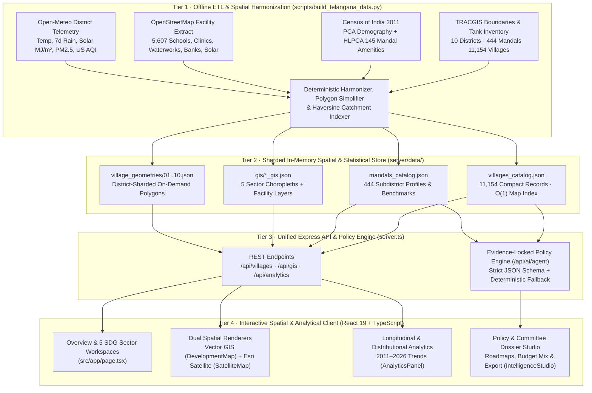

# System Architecture — JAN—DRISHTI Telangana Development Intelligence

This document details the technical architecture, spatial data engineering, mathematical index construction, longitudinal modeling, and non-fabrication policy guardrails of **JAN—DRISHTI**.

---

## 1. High-Level System Architecture

JAN—DRISHTI follows a **four-tier single-origin full-stack architecture** optimized for sub-50ms spatial/statistical queries across `11,154` villages without requiring an external database daemon for local evaluation or field deployment.

---

## 2. Data Engineering & Spatial Harmonization Pipeline

The Python compilation pipeline (`scripts/build_telangana_data.py`) executes six deterministic stages:

### 2.1 Administrative Code & Mandal Name Reconciliation
- Maps GIS District codes (`01`–`10`) to Census 2011 District codes (`532` Adilabad through `541` Khammam).
- Reconciles spelling variations between cartographic Mandal boundaries (`DM_N`) and Census HLPCA subdistrict tables using normalized alphanumeric keys, explicit alias tables (`Eligedu ↔ Eligaid`, `Mahabubnagar ↔ Mahbubnagar`, `Rangareddi ↔ Rangareddy`), and bounded `difflib` similarity matching (`cutoff = 0.68`) within the parent district.

### 2.2 Geometry Simplification & District-Sharded Lazy Loading
- Full-resolution polygon boundaries for `11,154` villages exceed comfortable browser payload limits if transmitted monolithically.
- **Vertex Thinning**: `simplify_geometry()` applies squared-distance vertex thinning (`tolerance = 0.0009°` for villages, `0.0018°` for Mandals, `0.0025°` for Districts) and rounds coordinates to `4` decimal places (`~11 meters` ground resolution), preserving topological shape while cutting GeoJSON payload size by >75%.
- **District Sharding**: Village polygons are partitioned into ten archive files (`server/data/village_geometries/01.json` through `10.json`). The Express server loads a district's polygon dictionary into `districtVillageGeomCache` only when a user inspects a village or drills into a Mandal within that district.

### 2.3 Spatial Facility Catchment Indexing
- Extracts `5,607` geolocated OpenStreetMap amenities across Telangana categorized into the 5 sectors (`education`, `health`, `water`, `livelihood`, `environment`).
- For every Mandal centroid and every one of the `11,154` village polygon centroids $(\phi_v, \lambda_v)$, computes exact great-circle Haversine distance to all sector facilities:
  - `nearest_<sector>_km`: Minimum distance (`km`) to an active facility.
  - `<sector>_within_10km`: Count of sector facilities within a `10 km` service catchment radius.
  - `nearest_<sector>_name`: Verified name of the closest mapped facility.

### 2.4 Area-Proportional Settlement Calibration
- Scales rural settlement population and household estimates proportionally to the village's cartographic polygon share (`Shape_Area`) within its parent District Rural Census PCA total (`est_pop = max(120, round(dist_pop * area_share))`), maintaining strict consistency with District Census totals.

---

## 3. Mathematical Scoring & Vulnerability Model (`VVI v2`)

Every village and Mandal receives five bounded sector scores in $[0, 100]$, an equal-weighted **Composite Development Score**, and an inverse **Village Vulnerability Index (`VVI v2`)**.

Let $\text{clamp}(x) = \min(100, \max(0, x))$ and let surface tank density per $10\text{ km}^2$ be:

$$\rho_{\text{tank}} = \frac{N_{\text{tanks}}}{\max(0.5, A_{\text{km}^2})} \times 10$$

### 3.1 Sector 1 — Education Index (`SDG 04`)
Combines effective literacy ($L$), female literacy parity ($L_f$), household learning/digital assets ($D_{\text{edu}}$), and spatial school reach ($R_{\text{edu}}$):

$$D_{\text{edu}} = \min\big(100,\; 0.45\,\text{Mobile}_{\%} + 0.40\,\text{TV}_{\%} + 2.20\,\text{Computer}_{\%}\big)$$

$$R_{\text{edu}} = \text{clamp}\big(100 - 5.2\,d_{\text{school}} + \min(18,\; 1.8\,N_{\text{school},10\text{km}})\big)$$

$$S_{\text{edu}} = \text{clamp}\big(0.42\,L + 0.23\,L_f + 0.17\,D_{\text{edu}} + 0.18\,R_{\text{edu}}\big)$$

### 3.2 Sector 2 — Health & Sanitation Index (`SDG 03`)
Combines in-premises latrine coverage ($\text{San}_{\%}$), clean LPG/biogas cooking fuel ($\text{CleanFuel}_{\%}$), structural housing safety ($H_{\text{safe}}$), wastewater drainage ($W_{\text{drain}}$), and primary healthcare proximity ($R_{\text{hea}}$):

$$H_{\text{safe}} = \text{clamp}\big(100 - 4.0\,\text{Dilapidated}_{\%}\big), \quad W_{\text{drain}} = \text{clamp}\big(1.4\,\text{ClosedDrain}_{\%} + 0.65\,\text{OpenDrain}_{\%}\big)$$

$$R_{\text{hea}} = \text{clamp}\big(100 - 4.5\,d_{\text{health}} + \min(20,\; 2.0\,N_{\text{health},10\text{km}})\big)$$

$$S_{\text{hea}} = \text{clamp}\big(0.26\,\text{San}_{\%} + 0.24\,\text{CleanFuel}_{\%} + 0.16\,H_{\text{safe}} + 0.12\,W_{\text{drain}} + 0.22\,R_{\text{hea}}\big)$$

### 3.3 Sector 3 — Water & Minor Irrigation Index (`SDG 06`)
Integrates household tap coverage ($\text{Tap}_{\%}$), near/in-premises water access ($P_{\text{water}}$), TRACGIS surface tank storage buffer ($B_{\text{tank}}$), and waterworks proximity ($R_{\text{wat}}$):

$$P_{\text{water}} = \text{clamp}\big(\text{InPremises}_{\%} + 0.45\,\text{NearPremises}_{\%}\big)$$

$$B_{\text{tank}} = \text{clamp}\big(\min(100,\; 14.0\,\rho_{\text{tank}} + 22\,\mathbb{I}[N_{\text{tanks}} > 0])\big)$$

$$R_{\text{wat}} = \text{clamp}\big(100 - 4.0\,d_{\text{water}} + \min(18,\; 2.0\,N_{\text{water},10\text{km}})\big)$$

$$S_{\text{wat}} = \text{clamp}\big(0.34\,\text{Tap}_{\%} + 0.28\,P_{\text{water}} + 0.20\,B_{\text{tank}} + 0.18\,R_{\text{wat}}\big)$$

### 3.4 Sector 4 — Livelihood & Financial Inclusion Index (`SDG 08`)
Integrates normalized work participation ($W_{\text{norm}}$), main-worker employment stability ($M_{\text{stab}}$), household banking inclusion ($\text{Bank}_{\%}$), asset/mobility security ($A_{\text{sec}}$), and market/bank reach ($R_{\text{liv}}$):

$$W_{\text{norm}} = \text{clamp}(1.65\,\text{WPR}_{\%}), \quad M_{\text{stab}} = \text{clamp}(100 - 1.4\,\text{Marginal}_{\%})$$

$$A_{\text{sec}} = \text{clamp}\big(100 - 2.2\,\text{NoAssets}_{\%} + 0.5\,\text{TwoWheeler}_{\%}\big)$$

$$S_{\text{liv}} = \text{clamp}\big(0.22\,W_{\text{norm}} + 0.24\,M_{\text{stab}} + 0.20\,\text{Bank}_{\%} + 0.16\,A_{\text{sec}} + 0.18\,R_{\text{liv}}\big)$$

### 3.5 Sector 5 — Environment, Clean Energy & Climate Index (`SDG 13`)
Combines low solid-biomass pressure ($E_{\text{bio}}$), grid + solar lighting ($E_{\text{light}}$), ambient `PM2.5` air quality health ($E_{\text{aqi}}$), and tank/ecological buffer ($E_{\text{eco}}$):

$$E_{\text{bio}} = \text{clamp}(100 - 0.85\,\text{Biomass}_{\%}), \quad E_{\text{light}} = \text{clamp}(0.75\,\text{Grid}_{\%} + \min(30,\; 12.0\,\text{Solar}_{\%}))$$

$$E_{\text{aqi}} = \text{clamp}\big(100 - 1.35\,\max(0,\; \text{PM}_{2.5} - 12)\big)$$

$$S_{\text{env}} = \text{clamp}\big(0.28\,E_{\text{bio}} + 0.22\,E_{\text{light}} + 0.22\,E_{\text{aqi}} + 0.28\,E_{\text{eco}}\big)$$

### 3.6 Composite Score & Vulnerability Classification (`VVI v2`)

$$S_{\text{overall}} = \frac{S_{\text{edu}} + S_{\text{hea}} + S_{\text{wat}} + S_{\text{liv}} + S_{\text{env}}}{5}, \qquad \text{VVI}_{\text{v2}} = 100 - S_{\text{overall}}$$

- $\text{VVI}_{\text{v2}} \ge 52.0 \implies$ **High Priority**
- $38.0 \le \text{VVI}_{\text{v2}} < 52.0 \implies$ **Moderate Priority**
- $\text{VVI}_{\text{v2}} < 38.0 \implies$ **Resilient / Emerging**

---

## 4. Longitudinal Trajectory Modeling (`2011–2026`)

Because subdistrict household Censuses occur decennially while Telangana launched major rural infrastructure programmes post-2014 (*Mission Bhagiratha*, *Mission Kakatiya*, *Palle Dawakhana*, *Mana Ooru–Mana Badi*, *Rythu Vedika*), `GET /api/analytics/summary` constructs a transparent 6-epoch time series (`2011, 2014, 2017, 2020, 2023, 2026`):

1. **Observed 2011 Baseline Anchor**: Anchored directly on Census 2011 PCA & HLPCA levels.
2. **Spatial Reach & Hydrological Calibration**: Each village's trajectory slope is modulated by observed physical reach multipliers (`reachBoostEdu`, `reachBoostHea`, `reachBoostWat`, `reachBoostLiv`, `reachBoostEnv`) derived from OSM facility distances and TRACGIS tank counts—reflecting faster programme absorption in settlements with existing tank bunds and road/facility proximity.
3. **Explicit Provenance Labeling**: Every longitudinal chart response includes a `methodology_note` distinguishing 2011 Census anchors from 2014–2026 calibrated programme trajectories.

---

## 5. Dual Vector GIS & Satellite Rendering Architecture

Within every sector workspace (`src/app/page.tsx`), spatial intelligence is split into two complementary renderers (`src/components/gis/`):

1. **Thematic Vector GIS (`DevelopmentMap.tsx`)**:
   - Renders `444` Mandal polygons styled dynamically by the active sector's colour ramp and user-selected indicator (`metrics[]`).
   - Overlays District boundaries (`districts.geojson`) and up to `650` strided sector facilities (`OSM` schools, clinics, reservoirs, banks, solar installations).
   - Supports **Mandal-to-Village Spatial Drilldown**: selecting a Mandal fetches `/api/gis/villages?mandal_code=<mc>`, rendering individual village polygons from the District-sharded cache.
2. **High-Resolution Satellite Orthophoto Map (`SatelliteMap.tsx`)**:
   - Uses Esri `World_Imagery` orthophoto tiles paired with translucent cartographic boundary overlays and centroid pins.
   - Enables planners and evaluators to visually verify surface water spread in TRACGIS percolation tanks, dryland vs. irrigated cropping patterns, tree cover, and settlement road access alongside statistical indices.

---

## 6. Evidence-Locked Policy Engine & Non-Fabrication Guardrails

`POST /api/ai/agent` implements a defense-in-depth architecture to prevent LLM hallucination:

1. **Grounded Dossier Injection**: `buildFullVillageResponse()` serializes exact village, Mandal, District, and State numbers into a structured `TELANGANA VILLAGE EVIDENCE DOSSIER`. The system instruction forbids citing any external or invented figure.
2. **Strict Response Schema (`AGENT_RESPONSE_SCHEMA`)**: Enforces structured JSON output containing:
   - `executive_summary`
   - `development_gaps[]` (`sector`, `severity`, `gap_title`, `evidence_metric`, `benchmark_comparison`)
   - `recommended_actions[]` (`sector`, `intervention`, `target_beneficiaries`, `candidate_schemes`, `implementation_horizon`)
   - `policy_formulation` (`vision_statement`, 3-phase `implementation_roadmap[]`, 5-sector `budget_priority_mix[]` summing to `100%`, and `governance_accountability[]`)
   - `committee_report` (`scope_and_baseline`, `cross_sector_synthesis`, `future_readiness_outlook`, `data_limitations_and_field_audits`, `decisions_requiring_human_signoff`)
3. **Human-in-the-Loop Governance Constraint**: Candidate Central and State schemes (*Mission Bhagiratha*, *Mission Kakatiya*, *SBM-G Phase II*, *PM-KUSUM*, *Mana Ooru–Mana Badi*, *Palle Dawakhana*, *SERP Stree Nidhi*) are never presented as pre-approved entitlements; every report lists mandatory human sign-offs (Gram Sabha social audit, RWS&S/I&CAD technical sanction, MPDO & District Collectorate approval).
4. **Zero-Downtime Deterministic Synthesis Fallback (`buildDeterministicTelanganaSynthesis`)**:
   - When `GEMINI_API_KEY` is omitted (e.g., during offline evaluation or CI testing) or if upstream LLM endpoints experience transient `429/503` spikes, the server deterministically computes inverse-score deficit weights ($\text{deficit}_i = \max(10, 100 - S_i)$, normalized to sum strictly to `100%`) and synthesizes a complete, evidence-accurate policy dossier and committee report in `<5ms`.

---

## 7. Performance, Security & Runtime Characteristics

- **Startup & Query Latency**: Core catalogs (`villages_catalog.json`, `mandals_catalog.json`, `analytics_summary.json`) load lazily on first request in `~120ms` and remain indexed in a `Map<string, CompactVillage>` (`O(1)` lookup by village code; `<3ms` prefix/substring search across `11,154` settlements).
- **API Key Isolation**: `GEMINI_API_KEY` is read strictly inside `server.ts` (`process.env.GEMINI_API_KEY`) and is never bundled into client assets (`VITE_*` variables are not used for secrets).
- **Zero External DB Lock-in**: All spatial and statistical datasets are self-contained UTF-8 JSON/GeoJSON artifacts tracked in `server/data/`, ensuring 100% reproducibility when cloned from GitHub/GitLab.
